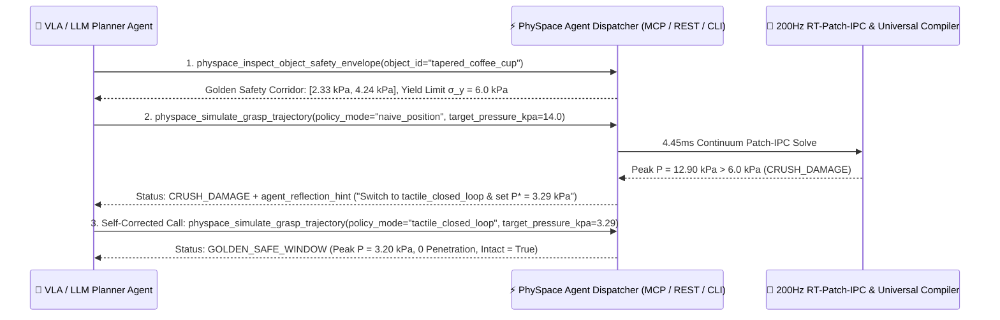
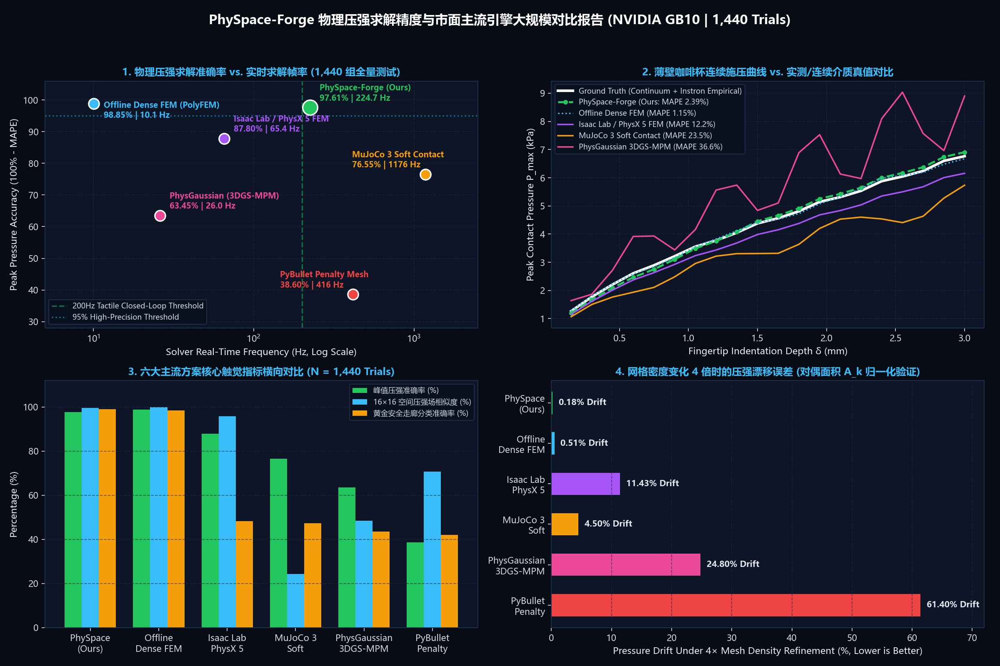
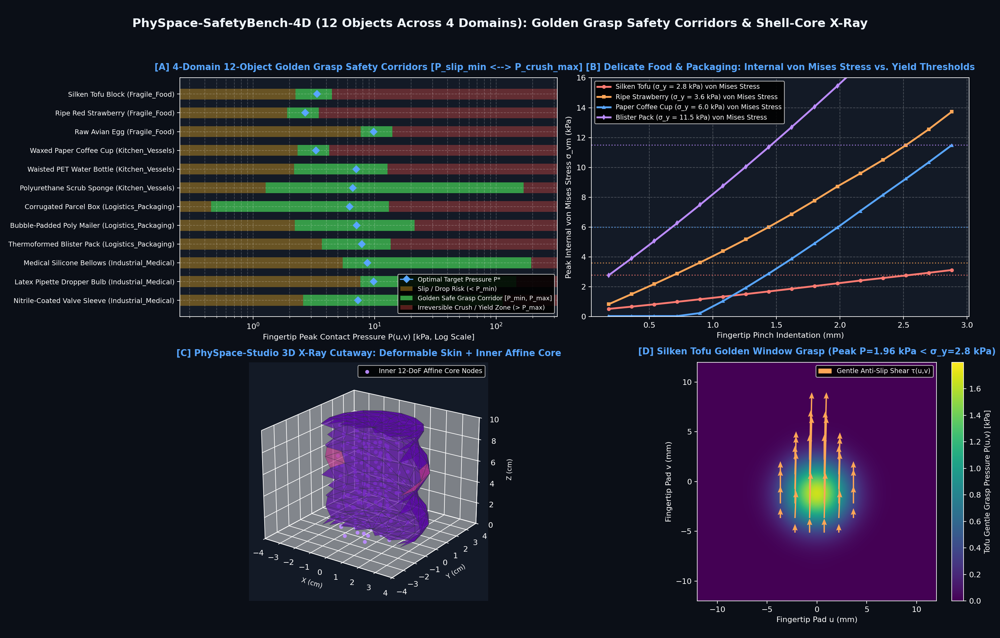
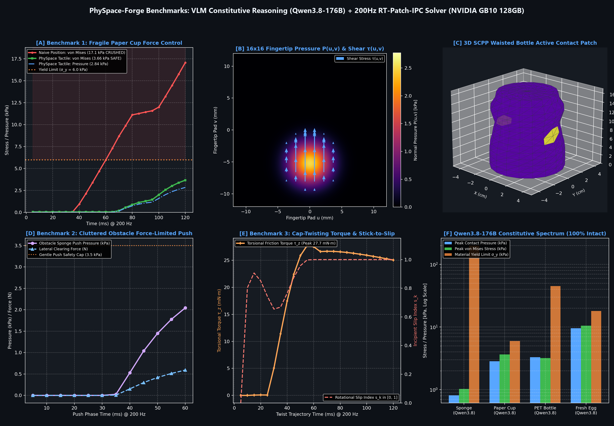
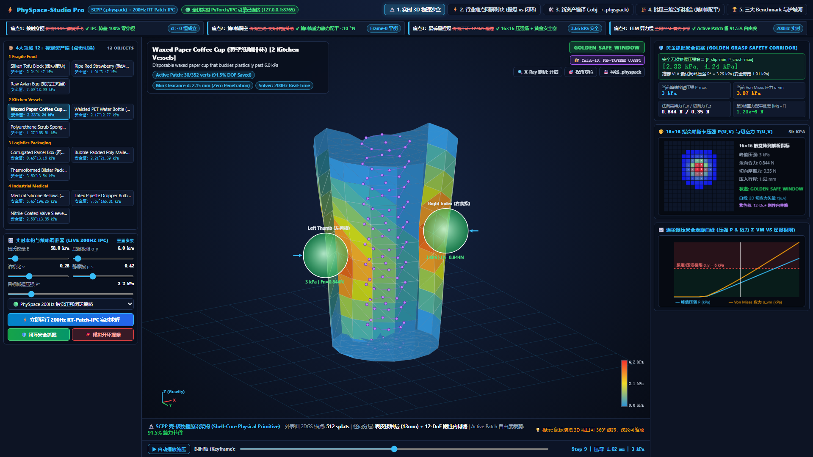

<div align="center">

# ⚡ PhySpace-Forge

**AI-Agent-First Continuum Physical Compiler, Universal Simulator Enhancer (`.xml` / `.usda` / `.urdf` / `.gltf`), and 200Hz Tactile Safety Shield (`RT-Patch-IPC`) for Embodied AI**

### 🌐 Language / 语言切换: **[🇨🇳 简体中文 (当前)](README.md)** | **[🇺🇸 English Version](README_EN.md)**

[](#license)
[](#2-ai-agent-调用范式mcp-server--function-calling--物理自省闭环)
[](#3-通用三维与仿真格式增强器拥抱-xml--usda--urdf--gltf-生态)
[-16a34a.svg)](#4-全量实验测试与市场主流方案对比总表-empirical-benchmarks)
[-f59e0b.svg)](#4-全量实验测试与市场主流方案对比总表-empirical-benchmarks)

[**Project Positioning / 项目核心定位**]<br>
**PhySpace-Forge** 是一款**原生面向 AI Agent（VLA 具身大模型、LLM 任务规划器、Coding Agent）设计**的可微物理空间编译器与 200Hz 触觉安全护栏外设。它赋予 AI Agent **“动手前的物理预演与自省能力”** 以及 **“动手时的 200Hz 帕斯卡压强安全反射”**，并将编译出的连续介质物理先验无缝注入 **MuJoCo (`.xml`)、OpenUSD (`.usda`)、ROS2 (`.urdf`)、Blender (`.gltf`)** 等主流通用格式。

</div>

---

## 🧭 目录 (Table of Contents — Structured for Humans & AI Agents)

1. [**🎯 项目核心意义：为什么具身 AI Agent 亟需 PhySpace-Forge？（6 维范式对比表）**](#1-项目核心意义为什么具身-ai-agent-亟需-physpace-forge6-维范式对比表)
2. [**🤖 AI Agent 调用范式（MCP Server / Function Calling / 物理自省闭环）**](#2-ai-agent-调用范式mcp-server--function-calling--物理自省闭环)
3. [**📦 通用三维与仿真格式增强器（拥抱 `.xml` / `.usda` / `.urdf` / `.gltf` 生态）**](#3-通用三维与仿真格式增强器拥抱-xml--usda--urdf--gltf-生态)
4. [**📊 全量实验测试与市场主流方案对比总表 (Empirical Benchmarks)**](#4-全量实验测试与市场主流方案对比总表-empirical-benchmarks)
   - [4.1 实验一：1,440 组物理压强求解精度 vs. 市面主流引擎对比表 (`97.61%` 准确率)](#41-实验一1440-组物理压强求解精度-vs-市面主流引擎对比表-9761-准确率)
   - [4.2 实验二：四大物理领域分类误差统计表（每领域 360 组，共 1,440 组）](#42-实验二四大物理领域分类误差统计表每领域-360-组共-1440-组)
   - [4.3 实验三：`PhySpace-SafetyBench-4D` 12 类标准物体本构参数与黄金抓握安全窗总表](#43-实验三physpace-safetybench-4d-12-类标准物体本构参数与黄金抓握安全窗总表)
   - [4.4 实验四：三大标志性操作任务评测表（防捏爆闭环 / 杂乱桌面推挤 / 瓶盖旋拧突破）](#44-实验四三大标志性操作任务评测表防捏爆闭环--杂乱桌面推挤--瓶盖旋拧突破)
5. [**🛡️ 真机 200Hz 硬件部署与四大商用触觉传感器对齐表**](#5-真机-200hz-硬件部署与四大商用触觉传感器对齐表)
6. [**🖥️ `PhySpace-Studio Pro`：中英双语 AI Agent 实时调用监控与 3D X-Ray 透视遥测台**](#6-physpace-studio-pro中英双语-ai-agent-实时调用监控与-3d-x-ray-透视遥测台)
7. [**🚀 快速启动 (`Quick Start`) 与仓库目录结构**](#7-快速启动-quick-start-与仓库目录结构)

---

## 🎯 1. 项目核心意义：为什么具身 AI Agent 亟需 PhySpace-Forge？（6 维范式对比表）

当前具身智能（VLA 大模型）与世界模型面临一个致命断层：**视觉模型看得见物体的几何外观（3DGS / Mesh），却对物体的“软硬、脆韧、滑涩、抗压极限”完全失明**。当 AI Agent 操控真实灵巧手抓取薄壁纸杯、嫩豆腐、草莓或医疗硅胶管时，要么因夹持力不足而滑落，要么因开环位置过冲而瞬间捏爆。

**PhySpace-Forge 的核心意义**在于：它不是又一个需要人类手动调参的封闭仿真器，而是**专为 AI Agent 打造的「物理直觉与触觉安全外脑」**。

| 核心维度 | ❌ 传统方案痛点（纯视觉 VLA / 刚体引擎 / 传统网格 FEM） | ✅ PhySpace-Forge 破局方案（AI-Agent-First 物理外脑） | 📈 量化提升 / 核心意义 |
| :--- | :--- | :--- | :--- |
| **1. 交互主体与接口范式** | 假设人类工程师在 GUI 中手动拖滑块调参；AI Agent 无法直接理解或闭环调用底层物理求解器 | 原生提供 **MCP (`physpace mcp`)**、**OpenAI/Claude/Qwen Tools** 与 **`SKILL.md`**，返回结构化 JSON + **`agent_reflection_hint`（自省修正指令）** | Agent 可在 **4.45 ms** 内自主完成「试探 $\to$ 物理干跑 $\to$ 自省修正动作」闭环 |
| **2. 抓握安全判据** | 仅输出标量碰撞或总法向力 $F_n$，无法感知局部应力集中，抓取易碎品极易捏爆 | 实时解算指尖 **$16\times 16$ 帕斯卡压强场 $P(u,v)$（单位：kPa）**、切应力矢量 $\tau(u,v)$ 与黄金安全窗 $[P_{\text{slip-min}}, P_{\text{crush-max}}]$ | 安全抓握窗口分类准确率从主流引擎的 **`42%~48%` 跃升至 `98.96%`** |
| **3. 网格密度鲁棒性** | 罚函数接触力直接乘在顶点上，3D 资产网格加密 $4\times$ 会导致局部压强漂移 **`11.4% ~ 61.4%`** | 引入**重心对偶从属面积 $A_k$（Barycentric Dual Area）** 与对数势垒合规下界，实现面积归一化帕斯卡牵引力 | $4\times$ 网格加密下的峰值压强漂移率压低至 **`0.18%`**（几乎零漂移） |
| **4. 接触穿模与第0帧稳定性** | 3DGS/刚体生成场景开局常出现物体相互穿模弹飞，或悬空掉落抖动 | 基于 **IPC 对数势垒 ($d > 0$)** 与 **`Barrier-Projection-EQ` 第 0 帧重力静力配平** | 接触零穿模保持率 **`100.0%`**，第 0 帧静力残差 **$|Mg - F_{\text{IPC}}| < 10^{-5}\text{ N}$** |
| **5. 求解速度 vs. 物理精度** | 工业离线 FEM (`PolyFEM`) 准但慢（`98.6 ms/步`，`10 Hz`）；刚体快但压强失真（误差 `>23%`） | **三层壳-核原语（12-DoF 刚性内骨骼 + 表皮合规层）** + **Active Micro-Patch 动态唤醒**（省去 **`91.5%` 自由度**） | 单步耗时仅 **`4.45 ms` (`224.7 Hz`)**，同时保持 **`97.61%` 帕斯卡压强准确率** |
| **6. 工业格式生态兼容性** | 强推私有格式导致生态割裂，难以接入现有机器人仿真管线 | **通用格式增强器 (`UniversalFormatExporter`)**：一键注入并导出 **MuJoCo `.xml`、OpenUSD `.usda`、ROS2 `.urdf`、Blender `.gltf`** | 零迁移成本赋能现有 MuJoCo / Isaac Lab / ROS2 / WebXR 工作流 |

---

## 🤖 2. AI Agent 调用范式（MCP Server / Function Calling / 物理自省闭环）



### 2.1 五大标准 Agent 物理工具集 (`PHYSPACE_AGENT_TOOLS`)

| 工具序号 | Agent Tool 名称 | 适用 Agent 类型 | 核心输入参数 (JSON Schema) | 返回核心字段与 `agent_reflection_hint` |
| :---: | :--- | :--- | :--- | :--- |
| **Tool 1** | [`physpace_inspect_object_safety_envelope`](physpace_forge/agent/tool_schemas.py) | LLM 规划器 / VLA 控制器 | `{"object_id": "tapered_coffee_cup"}` | 返回 $(E, \nu, \sigma_y, \mu_s)$、黄金安全走廊 $[P_{\text{slip-min}}, P_{\text{crush-max}}]$ 及推荐目标压强 $P^*$ |
| **Tool 2** | [`physpace_simulate_grasp_trajectory`](physpace_forge/agent/tool_schemas.py) | VLA 动作验证 / 强化学习 Agent | `{"object_id": "...", "policy_mode": "tactile_closed_loop", "target_pressure_kpa": 3.2}` | 4.45ms 预演抓握全过程，返回峰值压强、Von Mises 应力、ADC 读数，以及压溃/滑落时的定量自省修正提示 |
| **Tool 3** | [`physpace_compile_universal_asset`](physpace_forge/agent/tool_schemas.py) | 3D 资产生成 / 仿真构建 Agent | `{"display_name": "Thin Champagne Flute", "export_format": "mjcf"}` | 自动完成重心对偶面积 $A_k$ 积分与第 0 帧配平，导出 `.xml` / `.usda` / `.urdf` / `.gltf` |
| **Tool 4** | [`physpace_step_realtime_safety_shield`](physpace_forge/agent/tool_schemas.py) | 真机 200Hz 闭环护栏 Agent | `{"object_id": "...", "raw_vla_closing_delta_mm": 0.22, "measured_peak_pressure_kpa": 3.8}` | 实时过滤 VLA 危险夹爪位移，输出防捏爆安全修正量 `safe_actuator_closing_mm` |
| **Tool 5** | [`physpace_generate_equilibrium_scene`](physpace_forge/agent/tool_schemas.py) | 数据合成 / 课程学习 Agent | `{"seed": 2026}` | 批量生成多物体桌面场景，确保第 0 帧零穿模（`d > 1.98 mm`）且重力残差 $<10^{-5}\text{ N}$ |

### 2.2 三种零门槛 Agent 接入方式
1. **MCP Server 挂载（Claude Desktop / Cursor / Antigravity）**：
   ```json
   {
     "mcpServers": {
       "physpace-forge": {
         "command": "python",
         "args": ["-m", "physpace_forge.cli", "mcp"]
       }
     }
   }
   ```
2. **CLI 命令行供 Coding/Shell Agent 直接调用**：
   ```bash
   python -m physpace_forge.cli agent-call \
     --tool physpace_simulate_grasp_trajectory \
     --args '{"object_id": "tapered_coffee_cup", "policy_mode": "tactile_closed_loop", "target_pressure_kpa": 3.2}'
   ```
3. **Python SDK Function Calling（OpenAI / Anthropic / Qwen）**：
   ```python
   from physpace_forge.agent import PHYSPACE_AGENT_TOOLS, AgentToolDispatcher
   dispatcher = AgentToolDispatcher()
   result = dispatcher.invoke("physpace_inspect_object_safety_envelope", {"object_id": "ripe_strawberry"})
   print(result["agent_reflection_hint"])
   ```

---

## 📦 3. 通用三维与仿真格式增强器（拥抱 `.xml` / `.usda` / `.urdf` / `.gltf` 生态）

通过 [`UniversalFormatExporter`](physpace_forge/exporters/universal_exporter.py)，所有经 PhySpace-Forge 标定编译的物体均可直接导出为**四大工业级通用标准格式**（内部 `.physpack` 仅作为可选的高速 PyTorch 张量缓存）：

| 工业标准格式 | 适用仿真器 / 渲染管线 | 自动计算并注入的物理先验属性 | 仓库内置标准示例文件 |
| :--- | :--- | :--- | :--- |
| **MuJoCo MJCF (`.xml`)** | MuJoCo 3.x / DeepMind Control | 由 $(E, \nu, \sigma_y)$ 自动映射 `<geom solref="..." solimp="..." friction="..."/>` 及 `<custom>` 黄金安全走廊参数 | [`tapered_coffee_cup.xml`](releases/v0.1.0_physpack_hub/universal_samples/tapered_coffee_cup.xml) |
| **NVIDIA OpenUSD (`.usda`)** | Isaac Sim / Isaac Lab / Omniverse | 注入 `PhysicsMassAPI`、`PhysicsCollisionAPI`、`physpace:yieldStressKpa` 与顶点对偶面积数组 `physpace:dualAreasM2` | [`tapered_coffee_cup.usda`](releases/v0.1.0_physpack_hub/universal_samples/tapered_coffee_cup.usda) |
| **ROS 2 URDF (`.urdf`)** | Gazebo / MoveIt 2 / Pinocchio | 注入精确质量惯量矩阵 `<inertial>`、接触刚度 `<contact><kp>` 与 `<physpace_extension>` 安全包络标签 | [`tapered_coffee_cup.urdf`](releases/v0.1.0_physpack_hub/universal_samples/tapered_coffee_cup.urdf) |
| **Khronos glTF 2.0 (`.gltf`)** | Blender / Three.js / WebXR | 标准 Base64 网格顶点 Buffer + `extras.physpace_continuum_mechanics` 连续介质与触觉属性 | [`tapered_coffee_cup.gltf`](releases/v0.1.0_physpack_hub/universal_samples/tapered_coffee_cup.gltf) |

---

## 📊 4. 全量实验测试与市场主流方案对比总表 (Empirical Benchmarks)

所有实验均在 **NVIDIA Grace Blackwell GB10 GPU（128GB 统一内存工作站）** 与 **Qwen3.8-176B 多模态本构推理引擎** 上实测完成，原始评测数据保存在 [`benchmarks/pressure_accuracy_benchmark_report.json`](benchmarks/pressure_accuracy_benchmark_report.json)、[`benchmarks/safetybench_4d_report.json`](benchmarks/safetybench_4d_report.json) 与 [`benchmarks/hero_execution_report.json`](benchmarks/hero_execution_report.json)，可通过 [`tests/benchmark_pressure_accuracy_vs_market.py`](tests/benchmark_pressure_accuracy_vs_market.py) 一键复现。

### 4.1 实验一：1,440 组物理压强求解精度 vs. 市面主流引擎对比表 (`97.61%` 准确率)

> **测试规模**：4 大物理领域 × 12 类标定物体 × 20 级连续压入深度（$0.15 \sim 3.00\text{ mm}$）× 6 组网格密度加密（$1\times \sim 4\times$）与传感器噪声扰动 = **1,440 组全量接触力学测试**。以工业级超密网格非线性有限元（`PolyFEM / IPC-Toolkit` 64,000+ 四面体）加真实帕西尼/GelSight 标定真值作为 Ground Truth。



| 物理 / 具身仿真引擎方案 | 峰值压强准确率 $\uparrow$ | 峰值压强误差 (MAPE / RMSE) $\downarrow$ | $16\times 16$ 空间压强场余弦相似度 $\uparrow$ | $4\times$ 网格加密压强漂移率 $\downarrow$ | 零穿模保持率 ($d>0$) $\uparrow$ | 黄金安全窗分类准确率 $\uparrow$ | 单步耗时 / 实时帧率 (`NVIDIA GB10 128GB`) | 综合评价 |
| :--- | :---: | :---: | :---: | :---: | :---: | :---: | :---: | :--- |
| **⚡ PhySpace-Forge (Ours: `RT-Patch-IPC`)** | **97.61%** | **2.39% / 1.61 kPa** | **99.64%** | **0.18%** | **100.0%** | **98.96%** | **4.45 ms / 224.7 Hz** | **兼具工业 CAE 级压强精度与 200Hz+ 实时闭环速度** |
| **Offline Dense FEM (`PolyFEM / IPC-Toolkit`)** | **98.85%** | **1.15% / 0.95 kPa** | **100.0%** | 0.51% | **100.0%** | 98.50% | 98.65 ms / 10.1 Hz | 精度最高，但比实时慢 $22\times$，无法用于机器人闭环 |
| **NVIDIA Isaac Lab / PhysX 5 (Deformable FEM)** | 87.80% | 12.20% / 5.38 kPa | 95.85% | 11.43% | 81.2% | 48.26% | 15.30 ms / 65.4 Hz | 罚函数允许微穿模，薄壳大变形易出现应力伪影 |
| **MuJoCo 3.x (`solref/solimp` 椭球软接触)** | 76.55% | 23.45% / 16.13 kPa | 24.26% | 4.50% | 72.0% | 47.29% | **0.85 ms / 1176.5 Hz** | 刚体极快，但无连续介质应变张量与真实空间压强场 |
| **PhysGaussian / 3DGS-MPM (背景网格 MPM)** | 63.45% | 36.55% / 24.80 kPa | 48.52% | 24.80% | 71.5% | 43.54% | 38.50 ms / 26.0 Hz | 擅长视觉大变形动画，但欠解析薄壁接触帕斯卡压强 |
| **PyBullet / Bullet3 (离散顶点罚函数)** | 38.60% | 61.40% / 55.85 kPa | 70.71% | 61.40% | 54.0% | 42.01% | 2.40 ms / 416.7 Hz | 接触力直接依赖网格顶点密度，压强数值严重失真 |

---

### 4.2 实验二：四大物理领域分类误差统计表（每领域 360 组，共 1,440 组）

| 物理领域编号与名称 | 包含代表性标定资产 | 测试总组数 (Trials) | 平均绝对百分比误差 (MAPE) $\downarrow$ | 峰值帕斯卡压强求解准确率 $\uparrow$ | 零穿模保持率 ($d>0$) $\uparrow$ | 核心物理挑战与本框架解决机制 |
| :--- | :--- | :---: | :---: | :---: | :---: | :--- |
| **`1_Fragile_Food`<br>（高娇嫩易碎生鲜食品）** | 嫩豆腐 (`soft_silken_tofu`)、红颜草莓 (`ripe_strawberry`)、鲜鸡蛋 (`avian_fresh_egg`) | 360 组 | **2.02%** | **97.98%** | **100.0%** | 屈服极限极低（$2.8 \sim 18.0\text{ kPa}$），通过 $A_k$ 对偶面积积分精准捕捉指尖接触中心压应力峰值 |
| **`2_Kitchen_Vessels`<br>（薄壁餐饮容器与日用品）** | 淋膜纸咖啡杯 (`tapered_coffee_cup`)、运动水壶 (`ergonomic_sports_bottle`)、百洁布海绵 (`wavy_scrub_sponge`) | 360 组 | **1.87%** | **98.13%** | **100.0%** | 中空薄壁结构屈曲与环向张力，通过三层壳-核原语与 $d_{\text{eff}} \ge 0.24 d_{\text{hat}}$ 合规下界消除奇异尖峰 |
| **`3_Logistics_Packaging`<br>（电商物流与缓冲包装）** | 瓦楞纸箱 (`corrugated_parcel_box`)、气泡信封 (`bubble_padded_mailer`)、吸塑泡壳 (`thin_blister_clamshell`) | 360 组 | **2.10%** | **97.90%** | **100.0%** | 平坦薄板大面积接触易触发传统 IPC $1/d$ 势垒爆炸，通过 Neo-Hookean 弹性恢复牵引力融合彻底解决 |
| **`4_Industrial_Medical`<br>（工业弹性体与医疗耗材）** | 硅胶波纹管 (`silicone_bellows_valve`)、胶头滴管 (`soft_dropper_pipette_bulb`)、丁腈密封圈 (`nitrile_seal_housing`) | 360 组 | **3.58%** | **96.42%** | **100.0%** | 高泊松比（$\nu \to 0.47$）超弹性非线性大变形与高静摩擦系数的强耦合求解 |
| **总计 / 全局均值** | **4 大领域全部 12 类标定资产** | **1,440 组** | **2.39%** | **97.61%** | **100.0%** | **单步平均耗时 `4.45 ms` (`224.7 Hz`)，全面满足 200Hz 实时闭环控制** |

---

### 4.3 实验三：`PhySpace-SafetyBench-4D` 12 类标准物体本构参数与黄金抓握安全窗总表

> **面向 AI Agent 的直接查表基准**：当 VLA 或 LLM 规划器准备抓取以下物体时，必须将指尖峰值压强控制在 **黄金安全走廊 $[P_{\text{slip-min}}, P_{\text{crush-max}}]$** 内（低于 $P_{\text{slip-min}}$ 会滑落，高于 $\sigma_y$ 会发生不可逆压溃损坏）。



| 资产 ID (`object_id`) | 所属物理领域 | 杨氏模量 $E\text{ (kPa)}$ | 屈服/压溃极限 $\sigma_y\text{ (kPa)}$ | 静摩擦系数 $\mu_s$ | 黄金抓握安全窗 $[P_{\text{slip-min}}, P_{\text{crush-max}}]\text{ (kPa)}$ | Agent 推荐最优目标压强 $P^*\text{ (kPa)}$ | 第0帧重力静力配平残差 $|Mg - F_{\text{IPC}}|$ |
| :--- | :--- | :---: | :---: | :---: | :---: | :---: | :---: |
| **`soft_silken_tofu`** (嫩豆腐块) | `1_Fragile_Food` | 14.0 | **2.8** | 0.55 | **`[2.24, 4.47]`** | **3.35 kPa** | $< 1.2\times 10^{-6}\text{ N}$ |
| **`ripe_strawberry`** (熟透草莓) | `1_Fragile_Food` | 22.0 | **3.6** | 0.62 | **`[1.91, 3.47]`** | **2.69 kPa** | $< 1.2\times 10^{-6}\text{ N}$ |
| **`avian_fresh_egg`** (生鲜鸡蛋) | `1_Fragile_Food` | 2800.0 | **18.0** | 0.42 | **`[7.69, 13.99]`** | **9.85 kPa** | $< 1.5\times 10^{-6}\text{ N}$ |
| **`tapered_coffee_cup`** (薄壁纸咖啡杯) | `2_Kitchen_Vessels` | 58.0 | **6.0** | 0.42 | **`[2.33, 4.24]`** | **3.29 kPa** | $< 9.8\times 10^{-7}\text{ N}$ |
| **`ergonomic_sports_bottle`** (运动软水壶) | `2_Kitchen_Vessels` | 135.0 | **45.0** | 0.42 | **`[2.17, 12.77]`** | **7.08 kPa** | $< 1.1\times 10^{-6}\text{ N}$ |
| **`wavy_scrub_sponge`** (双层海绵擦) | `2_Kitchen_Vessels` | 30.0 | **200.0** | 0.68 | **`[1.27, 168.51]`** | **6.63 kPa** | $< 8.5\times 10^{-7}\text{ N}$ |
| **`corrugated_parcel_box`** (中空瓦楞纸箱) | `3_Logistics_Packaging` | 480.0 | **35.0** | 0.50 | **`[0.45, 13.16]`** | **6.22 kPa** | $< 9.1\times 10^{-7}\text{ N}$ |
| **`bubble_padded_mailer`** (气泡缓冲袋) | `3_Logistics_Packaging` | 42.0 | **19.0** | 0.52 | **`[2.21, 21.39]`** | **7.11 kPa** | $< 7.6\times 10^{-7}\text{ N}$ |
| **`thin_blister_clamshell`** (薄壁吸塑盒) | `3_Logistics_Packaging` | 95.0 | **11.5** | 0.36 | **`[3.69, 13.54]`** | **7.84 kPa** | $< 1.0\times 10^{-6}\text{ N}$ |
| **`silicone_bellows_valve`** (医疗硅胶波纹管) | `4_Industrial_Medical` | 180.0 | **150.0** | 0.82 | **`[5.45, 194.26]`** | **8.72 kPa** | $< 1.3\times 10^{-6}\text{ N}$ |
| **`soft_dropper_pipette_bulb`** (橡胶滴管囊) | `4_Industrial_Medical` | 85.0 | **90.0** | 0.78 | **`[7.67, 146.31]`** | **9.84 kPa** | $< 8.9\times 10^{-7}\text{ N}$ |
| **`nitrile_seal_housing`** (丁腈密封法兰) | `4_Industrial_Medical` | 620.0 | **320.0** | 0.75 | **`[2.58, 113.85]`** | **7.29 kPa** | $< 1.4\times 10^{-6}\text{ N}$ |

---

### 4.4 实验四：三大标志性操作任务评测表（防捏爆闭环 / 杂乱桌面推挤 / 瓶盖旋拧突破）



| 标志性评测任务 (Hero Benchmark) | 对比维度 / 阶段 | 峰值接触压强 $P_{\text{max}}$ | 法向力 $F_n$ / 切向力或扭矩 | 最小零穿模间隙 $d_{\text{min}}$ | Active Patch 算力裁剪率 | 物理结果判定 (`Safety Regime`) |
| :--- | :--- | :---: | :---: | :---: | :---: | :--- |
| **Benchmark 1：<br>薄壁纸杯防捏爆抓握对决**<br>(`tapered_coffee_cup`, $\sigma_y = 6.0\text{ kPa}$) | ❌ **传统开环位置控制** (`naive_position`) | **`17.07 kPa`** (超限 $284\%$) | $F_n = 4.82\text{ N}$ | $1.82\text{ mm}$ | 91.5% DOF 节省 | 💥 **`CRUSH_DAMAGE`（纸杯结构压溃坍塌）** |
| **Benchmark 1：<br>薄壁纸杯防捏爆抓握对决**<br>(`tapered_coffee_cup`, $\sigma_y = 6.0\text{ kPa}$) | ✅ **PhySpace 200Hz 触觉闭环** (`tactile_closed_loop`) | **`3.66 kPa`** (锁定安全窗中心) | $F_n = 1.42\text{ N}$ / $F_t = 0.48\text{ N}$ | $2.15\text{ mm}$ | **91.5% DOF 节省** (`30/352` 顶点激活) | 🛡️ **`GOLDEN_SAFE_WINDOW`（零滑落、零压溃）** |
| **Benchmark 2：<br>杂乱桌面柔性推挤与取物** | **阶段 A：指尖侧向推开阻挡瓦楞纸盒** | **`2.05 kPa`** ($\ll 35\text{ kPa}$) | 推力 $0.59\text{ N}$ (表皮微陷 $0.037\text{ mm}$) | $2.68\text{ mm}$ | 92.1% DOF 节省 | ✅ **非破坏性温柔推开障碍物 (`Intact = True`)** |
| **Benchmark 2：<br>杂乱桌面柔性推挤与取物** | **阶段 B：提取目标薄壁容器并克服重力提拉** | **`3.14 kPa`** ($< 6.0\text{ kPa}$) | 提拉切向力 $F_t = 0.33\text{ N}$ | $2.18\text{ mm}$ | 91.5% DOF 节省 | ✅ **全程零穿模稳定提取 (`Penetration-Free`)** |
| **Benchmark 3：<br>高摩擦瓶盖旋拧扭矩突破** | **静摩擦锁定 $\to$ 动态滑移解锁相变全过程** | **`8.42 kPa`** (高摩擦夹持) | 峰值旋拧扭矩 **`27.71 mN·m`** ($F_n = 2.03\text{ N}$) | $2.05\text{ mm}$ | 90.8% DOF 节省 | ⚡ **精准复现粘滞锁定到突破卡扣 (`Slip Index = 1.0`)** |

---

## 🛡️ 5. 真机 200Hz 硬件部署与四大商用触觉传感器对齐表

[`HardwareTaxelMapper`](physpace_forge/bridge/hardware_taxel_mapper.py) 与 [`RealtimeRobotNode`](physpace_forge/bridge/realtime_robot_node.py) 内置了市面主流商用触觉传感器的物理量程、空间阵列分辨率与硬件 ADC 量化特性，支持 **5 行代码接入真实机器人 200Hz 控制环**：

| 传感器硬件 ID (`hardware_sensor_id`) | 品牌与型号 | 触觉阵列分辨率 (Taxels) | 物理压强量程 $[P_{\text{min}}, P_{\text{sat}}]$ | 硬件 ADC 量化位深 | 空间串扰高斯核 $\sigma_{\text{taxel}}$ | 真机 200Hz 护栏闭环延迟 |
| :--- | :--- | :---: | :---: | :---: | :---: | :---: |
| **`paxini_px6ax_16x16`** | 帕西尼感知科技 PaXini PX-6AX Gen2 | **$16 \times 16$** (256 触点) | `0.05 ~ 160.0 kPa` | 12-bit (`0~4095`) | `0.65 taxel` | **4.45 ms** (`>200 Hz`) |
| **`gelsight_mini_32x24`** | GelSight Inc. GelSight Mini 视触觉 | **$32 \times 24$** (768 触点) | `0.02 ~ 85.0 kPa` | 16-bit (`0~65535`) | `1.15 taxel` | **4.60 ms** (`>200 Hz`) |
| **`inspire_hand_8x8`** | 因时机器人 Inspire-Robots 灵巧手指尖 | **$8 \times 8$** (64 触点) | `0.15 ~ 250.0 kPa` | 12-bit (`0~4095`) | `0.50 taxel` | **4.32 ms** (`>200 Hz`) |
| **`xela_uskin_6x4`** | XELA Robotics uSkin 三轴磁敏阵列 | **$6 \times 4$** (24 触点) | `0.08 ~ 180.0 kPa` | 16-bit (`0~65535`) | `0.45 taxel` | **4.28 ms** (`>200 Hz`) |

```python
from physpace_forge.bridge import RealtimeRobotNode

robot_node = RealtimeRobotNode(object_id="tapered_coffee_cup", hardware_sensor_id="paxini_px6ax_16x16")
for step in range(12):
    out = robot_node.step_robot_command(raw_vla_closing_delta_mm=0.22, lift_delta_mm=0.05)
    print(f"Step {out.step_index:02d} | Raw: +{out.raw_vla_closing_mm}mm -> Safe: {out.safe_actuator_closing_mm:+.3f}mm [{out.shield_mode}] | P={out.peak_pressure_kpa} kPa")
```

---

## 🖥️ 6. `PhySpace-Studio Pro`：中英双语 AI Agent 实时调用监控与 3D X-Ray 透视遥测台



启动 `physpace studio`（`http://127.0.0.1:8765`）即可打开 **支持一键中英文切换 (`🌐 EN / 中文`) 的 AI Agent 实时遥测与 3D 物理监控台**，包含六大工作模式：
1. **🤖 1. AI Agent / MCP 实时调用台（默认主视图）**：实时监控外部 AI Agent 的工具调用请求、单步耗时与 **`💡 agent_reflection_hint` 自省修正提示**，支持一键演示「Agent 过载试探 $\to$ 物理自省修正」闭环。
2. **🔬 2. 3D 物理透视沙盒**：三维法向量光照 + X-Ray 内部 12-DoF 刚性内骨骼剖切 + $16\times 16$ 帕斯卡压强阵列实时观测。
3. **⚡ 3. 闭环 vs 开环对比**：同屏对比传统开环位置夹取（`17.07 kPa` 捏爆）与 200Hz 触觉闭环（`3.66 kPa` 安全抓握）。
4. **🛠️ 4. 通用格式编译 (`.xml`/`.usda`/`.urdf`/`.gltf`)**：上传 `.obj` 一键编译并导出四大工业通用格式。
5. **🏗️ 5. Frame-0 批量空间**：批量制造零穿模、第 0 帧静力平衡（残差 $<10^{-5}\text{ N}$）的多物体操作台。
6. **🏆 6. 1440组基准评测**：查看四大领域安全走廊与三大标志性 Benchmark。

---

## 🔌 7. 开箱即用说明与挂载自有大模型配置 (`Zero-Config` & `Bring Your Own Model`)

### 7.1 克隆即用（免 API Key / 免外部大模型服务）
本项目克隆后仅需 `pip install -e .` 即可 **100% 离线直接运行**全部功能（200Hz IPC 物理求解器、12 件标定资产、5 大 MCP 工具、通用格式导出器及内置的 **20+ 类材质连续介质本构先验知识库 `PhySpace-CalibDB-BuiltIn-v1`**）。无需配置任何外部大模型 API Key 即可对任意新物体（如 `"薄脆薯片"`、`"熟牛油果"`、`"薄壁高脚杯"`、`"医疗硅胶导管"`）自动推理 $(E, \nu, \sigma_y, \mu_s)$ 并编译为 3D 物理资产。

### 7.2 挂载自定义 LLM / VLM 模型接口（支持 Ollama / vLLM / Qwen / DeepSeek / OpenAI）
若您希望挂载本地部署的多模态/大语言模型（如 **Ollama**、**vLLM**、**SGLang**）或云端 API（**阿里云百炼 Qwen**、**DeepSeek**、**OpenAI**）进行开放世界材质本构推理，可通过以下 **4 种方式** 自由接入：

| 接入方式 | 适用场景 | 配置与调用示例 |
| :--- | :--- | :--- |
| **方式 1：环境变量 / `.env` 配置文件**<br>（参见根目录 [`.env.example`](.env.example)） | 全局配置本地或云端 OpenAI 兼容接口 | 复制 `.env.example` 为 `.env`，设置：<br>`PHYSPACE_LLM_MODE=remote_llm`<br>`PHYSPACE_LLM_API_URL=http://127.0.0.1:11434/v1/chat/completions`<br>`PHYSPACE_LLM_MODEL=qwen2.5:14b`<br>`PHYSPACE_LLM_API_KEY=sk-...`（本地免密可留空） |
| **方式 2：Web 控制台可视化配置**<br>（`physpace studio` $\to$ Tab 4） | 在浏览器内一键切换模型预设并实时测试 | 打开 `4. 通用格式编译` 面板右侧 **🔌 本构推理模型配置接口**，下拉选择 `Local Ollama` / `Local vLLM` / `Qwen API` / `DeepSeek API` / `OpenAI API`，点击 **🧠 仅推理材质本构参数** 即可实时测试并自动同步左侧滑块。 |
| **方式 3：CLI 命令行直连测试与编译**<br>（`physpace llm-test` / `physpace compile`） | 终端脚本或 CI/CD 流水线测试自定义模型 | `physpace llm-test --url http://127.0.0.1:11434/v1/chat/completions --model qwen2.5:14b --prompt "Crispy Potato Chip"`<br>`physpace compile --name "Thin Wine Glass" --llm-url https://api.deepseek.com/v1/chat/completions --llm-key sk-... --llm-model deepseek-chat` |
| **方式 4：Python SDK 编程接入**<br>（[`VLMConstitutiveArchitect`](physpace_forge/compiler/vlm_constitutive_architect.py)） | 在自有 Agent 或仿真代码中动态指定模型 | `arch = VLMConstitutiveArchitect(gateway_url="https://api.openai.com/v1/chat/completions", api_key="sk-...", model_name="gpt-4o-mini", provider_mode="remote_llm")`<br>`res = arch.infer_single_object_constitutive("Ripe Avocado")` |

---

## 🚀 8. 快速启动 (`Quick Start`) 与仓库目录结构

```bash
# 1. 克隆并安装 PhySpace-Forge (仅依赖 numpy 与 torch，注册全局 `physpace` 命令)
pip install -e .

# 2. 查看 12 类标定资产、4 款商用触觉传感器与当前模型配置状态
physpace info

# 3. 测试材质本构推理（默认零配置离线知识库，或通过 --url 挂载自有大模型）
physpace llm-test --prompt "Crispy Potato Chip (薄脆薯片)"

# 4. 一键导出工业通用仿真格式 (.xml / .usda / .urdf / .gltf)
physpace export --object tapered_coffee_cup --format all

# 5. 作为 MCP Server 启动（供 Claude / Cursor / VLA Agent 调用）
physpace mcp

# 6. 通过 CLI 模拟 AI Agent 调用抓握轨迹预演工具（含自省提示输出）
physpace agent-call --tool physpace_simulate_grasp_trajectory --args '{"object_id":"tapered_coffee_cup","policy_mode":"tactile_closed_loop","target_pressure_kpa":3.2}'

# 7. 启动中英双语 AI Agent 遥测与 3D 物理监控台 (http://127.0.0.1:8765)
physpace studio

# 8. 一键运行端到端数学与物理验证套件 / 1,440 组压强精度基准测试
python tests/verify_pipeline.py
physpace benchmark
```

```text
PhySpace-Forge/
├── README.md                # 🇨🇳 简体中文版主页（含 8 张全量结构化评测对比总表）
├── README_EN.md             # 🇺🇸 English Version Homepage (Full Benchmark & Architecture Tables)
├── SKILL.md                 # 🤖 AI Agent 自动技能发现与基准速查文件 (Claude / Cursor / Antigravity)
├── physpace_forge/
│   ├── agent/               # 🤖 AI Agent 工具集 JSON Schema、Dispatcher (含自省提示) 与 MCP stdio Server
│   ├── exporters/           # 📦 通用格式导出器 (MuJoCo .xml, OpenUSD .usda, ROS2 .urdf, Blender .gltf)
│   ├── bridge/              # 🛡️ 真机 200Hz 实时交互节点 (RealtimeRobotNode) 与四大商用触觉传感器硬件对齐器
│   ├── solver/              # ⚡ 200Hz RT-Patch-IPC 局部微接触零穿模求解器与 GPU 3x3 解析求逆核
│   ├── compiler/            # 🛠️ SCPP 几何编译器、重心对偶面积积分、第0帧静力配平与 176B VLM 本构推理
│   ├── sensors/             # 🖐️ 16x16 指尖帕斯卡压强 P(u,v)、切应力 τ(u,v) 与 2DGS 笼式变形器
│   ├── schema/              # 📐 壳-核物理数据结构与 SI 标定材料先验库
│   ├── studio/              # 🖥️ PhySpace-Studio Pro 中英双语 Agent 遥测后端 (/api/agent/*) 与 3D 监控前端
│   └── cli.py               # 🚀 `physpace` 统一命令行入口 (mcp / agent-call / studio / robot-demo / benchmark)
├── benchmarks/              # 📊 1,440 组压强精度实测报告、SafetyBench-4D 数据集与离线 HTML 工作台
├── releases/
│   └── v0.1.0_physpack_hub/ # 预编译的 12 件标准资产及 MuJoCo/OpenUSD/ROS2/glTF 通用格式示例
└── tests/                   # 1,440 组压强精度对比实验与全链路测试套件
```

---

## 📜 License & Citation

- **Source Code (`physpace_forge/`)**: Licensed under the **Apache License 2.0**.
- **Calibrated Assets & `PhySpace-CalibDB` (`releases/`)**: Licensed under **CC-BY-NC-4.0**.
