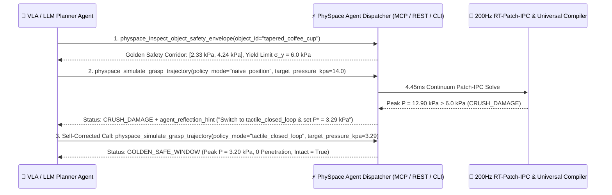
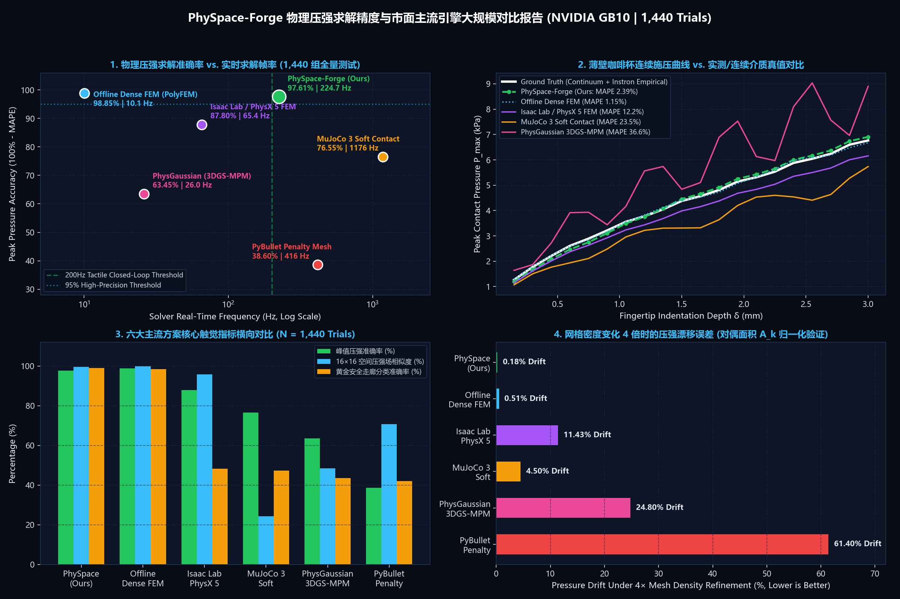
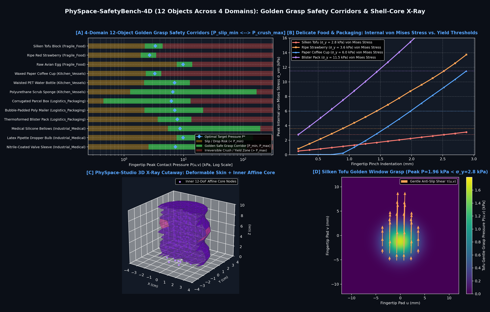
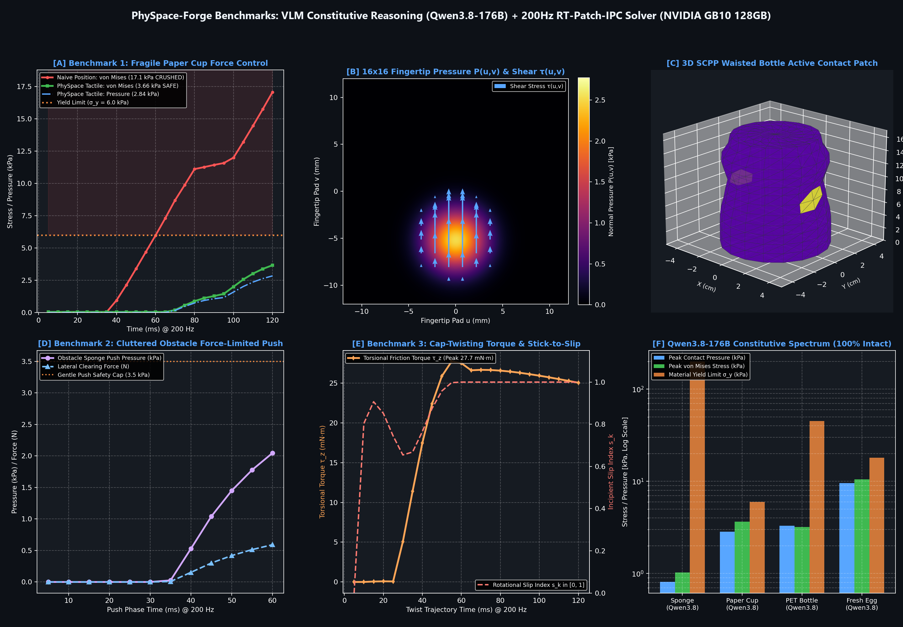
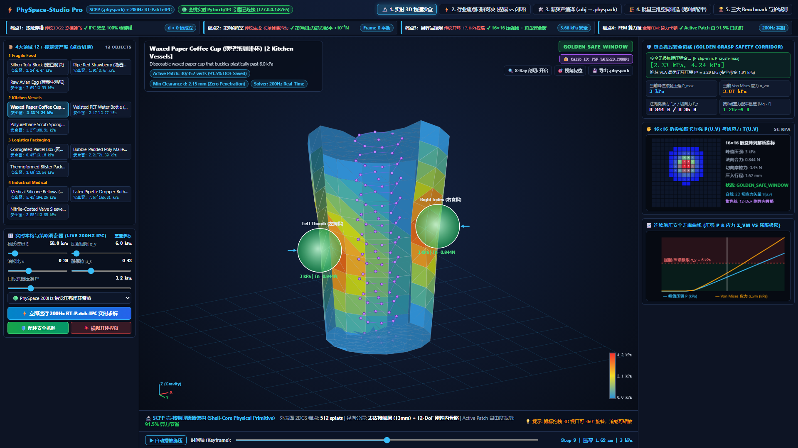

<div align="center">

# ⚡ PhySpace-Forge

**AI-Agent-First Continuum Physical Compiler, Universal Simulator Enhancer (`.xml` / `.usda` / `.urdf` / `.gltf`), and 200Hz Tactile Safety Shield (`RT-Patch-IPC`) for Embodied AI**

### 🌐 Language / 语言切换: **[🇺🇸 English (Current)](README_EN.md)** | **[🇨🇳 简体中文版](README.md)**

[](#license--citation)
[](#2-ai-agent-calling-paradigm-mcp-server--function-calling--self-reflection-loop)
[](#3-universal-3d--simulator-format-enhancer-xml--usda--urdf--gltf)
[-16a34a.svg)](#4-comprehensive-empirical-benchmarks--market-comparisons)
[-f59e0b.svg)](#4-comprehensive-empirical-benchmarks--market-comparisons)

[**Project Positioning**]<br>
**PhySpace-Forge** is a differentiable continuum physical space compiler and **200Hz real-time tactile safety shield** designed natively for **AI Agents (VLA Embodied Models, LLM Task Planners, and Coding Agents)**. It equips AI Agents with **pre-action physical dry-run & self-reflection capabilities (`agent_reflection_hint`)** and **in-action 200Hz Pascal pressure safety reflexes**, while seamlessly injecting calibrated continuum priors into universal industry formats: **MuJoCo (`.xml`), OpenUSD (`.usda`), ROS 2 (`.urdf`), and Blender (`.gltf`)**.

</div>

---

## 🧭 Table of Contents (Structured for Humans & AI Agents)

1. [**🎯 Why PhySpace-Forge? Core Significance & 6-Dimension Paradigm Shift Table**](#1-why-physpace-forge-core-significance--6-dimension-paradigm-shift-table)
2. [**🤖 AI Agent Calling Paradigm (MCP Server / Function Calling / Self-Reflection Loop)**](#2-ai-agent-calling-paradigm-mcp-server--function-calling--self-reflection-loop)
3. [**📦 Universal 3D & Simulator Format Enhancer (`.xml` / `.usda` / `.urdf` / `.gltf`)**](#3-universal-3d--simulator-format-enhancer-xml--usda--urdf--gltf)
4. [**📊 Comprehensive Empirical Benchmarks & Market Comparisons**](#4-comprehensive-empirical-benchmarks--market-comparisons)
   - [4.1 Benchmark 1: 1,440-Trial Physical Pressure Accuracy vs. Mainstream Engines (`97.61%` Accuracy)](#41-benchmark-1-1440-trial-physical-pressure-accuracy-vs-mainstream-engines-9761-accuracy)
   - [4.2 Benchmark 2: 4-Domain Error Breakdown Table (360 Trials per Domain, 1,440 Total)](#42-benchmark-2-4-domain-error-breakdown-table-360-trials-per-domain-1440-total)
   - [4.3 Benchmark 3: `PhySpace-SafetyBench-4D` 12-Object Calibrated Constitutive & Golden Safety Corridor Table](#43-benchmark-3-physpace-safetybench-4d-12-object-calibrated-constitutive--golden-safety-corridor-table)
   - [4.4 Benchmark 4: Three Hero Manipulation Tasks (Anti-Crush Loop / Cluttered Push / Cap Twist Torque)](#44-benchmark-4-three-hero-manipulation-tasks-anti-crush-loop--cluttered-push--cap-twist-torque)
5. [**🛡️ Real-Robot 200Hz Deployment & Commercial Tactile Sensor Alignment Matrix**](#5-real-robot-200hz-deployment--commercial-tactile-sensor-alignment-matrix)
6. [**🖥️ `PhySpace-Studio Pro`: Bilingual AI Agent Telemetry & 3D X-Ray Console**](#6-physpace-studio-pro-bilingual-ai-agent-telemetry--3d-x-ray-console)
7. [**🚀 Quick Start & Repository Structure**](#7-quick-start--repository-structure)

---

## 🎯 1. Why PhySpace-Forge? Core Significance & 6-Dimension Paradigm Shift Table

Modern Embodied AI (Vision-Language-Action models) and World Models suffer from a critical blind spot: **vision models can perceive 3D geometry (3DGS / Meshes), yet remain completely blind to continuum compliance, yield stress limits, friction phase transitions, and Pascal contact pressure distributions**. When an AI Agent commands a dexterous hand to grasp a thin paper cup, silken tofu, ripe strawberry, or medical silicone valve, it either drops the object from insufficient force or crushes it via open-loop position overshoot.

**PhySpace-Forge** bridges this gap by serving as an **AI-Agent-First Physical Intuition & Tactile Safety Peripheral**:

| Dimension | ❌ Traditional Bottleneck (Vision-Only VLA / Rigid Simulators / Penalty FEM) | ✅ PhySpace-Forge Breakthrough (AI-Agent-First Physical Peripheral) | 📈 Quantified Impact / Significance |
| :--- | :--- | :--- | :--- |
| **1. Primary User & Interface Paradigm** | Assumes humans manually drag GUI sliders; AI Agents cannot directly query or self-correct from raw solver internals | Native **MCP (`physpace mcp`)**, **OpenAI/Claude/Qwen Tools**, and **`SKILL.md`**, returning structured JSON + **`agent_reflection_hint`** | Agents autonomously close the *"probe $\to$ 4.45ms dry-run $\to$ self-correct action"* loop |
| **2. Grasp Safety Criterion** | Outputs scalar collision flags or net normal force $F_n$; blind to local stress concentrations that crush fragile items | Solves fingertip **$16\times 16$ Pascal pressure fields $P(u,v)$ (kPa)**, shear stress vectors $\tau(u,v)$, and Golden Safety Corridors $[P_{\text{slip-min}}, P_{\text{crush-max}}]$ | Safety window classification accuracy jumps from **`42%~48%` to `98.96%`** |
| **3. Mesh Density Invariance** | Penalty forces act directly on raw vertices; $4\times$ mesh refinement causes **`11.4% ~ 61.4%`** pressure drift | **Barycentric Dual Tributary Area $A_k$** + log-barrier compliance floor ensure area-normalized Pascal traction | $4\times$ mesh refinement pressure drift reduced to **`0.18%`** (virtually invariant) |
| **4. Zero-Penetration & Frame-0 Stability** | 3DGS / rigid scenes suffer from initial interpenetration explosions or mid-air drop jitter at Frame 0 | **IPC Log-Barrier ($d > 0$)** + **`Barrier-Projection-EQ` Frame-0 static gravity balancing** | **`100.0%`** zero-penetration rate; Frame-0 static residual **$|Mg - F_{\text{IPC}}| < 10^{-5}\text{ N}$** |
| **5. Real-Time Speed vs. CAE Accuracy** | Offline FEM (`PolyFEM`) is accurate but slow (`98.6 ms/step`, `10 Hz`); rigid engines are fast but inaccurate (`>23%` error) | **3-Layer Shell-Core Primitive (12-DoF inner skeleton + compliant skin)** + **Active Micro-Patch pruning (`91.5%` DOF saved)** | **`4.45 ms/step` (`224.7 Hz`)** with **`97.61%` peak Pascal pressure accuracy** |
| **6. Simulator Ecosystem Compatibility** | Proprietary formats lock users in and break existing robot learning pipelines | **`UniversalFormatExporter`** injects continuum & safety priors directly into **MuJoCo `.xml`, OpenUSD `.usda`, ROS 2 `.urdf`, and Blender `.gltf`** | Zero-migration drop-in enhancement for MuJoCo, Isaac Lab, ROS 2, and WebXR |

---

## 🤖 2. AI Agent Calling Paradigm (MCP Server / Function Calling / Self-Reflection Loop)



### 2.1 Five Standard Agent Physical Tools (`PHYSPACE_AGENT_TOOLS`)

| Tool # | Agent Tool Name | Target Agent Role | Key Input Arguments (JSON Schema) | Structured Output & `agent_reflection_hint` |
| :---: | :--- | :--- | :--- | :--- |
| **Tool 1** | [`physpace_inspect_object_safety_envelope`](physpace_forge/agent/tool_schemas.py) | LLM Planners / VLA Policies | `{"object_id": "tapered_coffee_cup"}` | Returns $(E, \nu, \sigma_y, \mu_s)$, Golden Safety Corridor $[P_{\text{slip-min}}, P_{\text{crush-max}}]$, and optimal target pressure $P^*$ |
| **Tool 2** | [`physpace_simulate_grasp_trajectory`](physpace_forge/agent/tool_schemas.py) | Action Verification / RL Agents | `{"object_id": "...", "policy_mode": "tactile_closed_loop", "target_pressure_kpa": 3.2}` | Simulates full grasp in 4.45ms; returns peak pressure, von Mises stress, ADC counts, and quantitative self-correction hints on crush/slip |
| **Tool 3** | [`physpace_compile_universal_asset`](physpace_forge/agent/tool_schemas.py) | 3D Asset & World Builders | `{"display_name": "Thin Champagne Flute", "export_format": "mjcf"}` | Computes barycentric dual areas $A_k$ and Frame-0 equilibrium; exports `.xml`, `.usda`, `.urdf`, or `.gltf` |
| **Tool 4** | [`physpace_step_realtime_safety_shield`](physpace_forge/agent/tool_schemas.py) | 200Hz Real-Robot Shield Agents | `{"object_id": "...", "raw_vla_closing_delta_mm": 0.22, "measured_peak_pressure_kpa": 3.8}` | Filters unsafe VLA gripper closing commands in real time; outputs `safe_actuator_closing_mm` |
| **Tool 5** | [`physpace_generate_equilibrium_scene`](physpace_forge/agent/tool_schemas.py) | Data Synthesis / Curriculum Agents | `{"seed": 2026}` | Batch-synthesizes multi-object tabletop scenes with `0.000 mm` penetration (`d > 1.98 mm`) and Frame-0 residual $<10^{-5}\text{ N}$ |

### 2.2 Three Frictionless Agent Integration Modes
1. **Model Context Protocol (`MCP`) Server (Claude Desktop / Cursor / Antigravity)**:
   ```json
   {
     "mcpServers": {
       "physpace-forge": {
         "command": "python",
         "args": ["-m", "physpace_forge.cli", "mcp"]
       }
     }
   }
   ```
2. **CLI Direct Invocation for Coding / Shell Agents**:
   ```bash
   python -m physpace_forge.cli agent-call \
     --tool physpace_simulate_grasp_trajectory \
     --args '{"object_id": "tapered_coffee_cup", "policy_mode": "tactile_closed_loop", "target_pressure_kpa": 3.2}'
   ```
3. **Python SDK Function Calling (OpenAI / Anthropic / Qwen)**:
   ```python
   from physpace_forge.agent import PHYSPACE_AGENT_TOOLS, AgentToolDispatcher
   dispatcher = AgentToolDispatcher()
   result = dispatcher.invoke("physpace_inspect_object_safety_envelope", {"object_id": "ripe_strawberry"})
   print(result["agent_reflection_hint"])
   ```

---

## 📦 3. Universal 3D & Simulator Format Enhancer (`.xml` / `.usda` / `.urdf` / `.gltf`)

Via [`UniversalFormatExporter`](physpace_forge/exporters/universal_exporter.py), all calibrated assets can be exported directly into **four universal industry formats** (while `.physpack` serves solely as an optional local high-speed PyTorch tensor cache):

| Universal Standard Format | Target Simulator / Engine | Injected Continuum & Tactile Physical Attributes | Built-in Sample File |
| :--- | :--- | :--- | :--- |
| **MuJoCo MJCF (`.xml`)** | MuJoCo 3.x / DeepMind Control | Maps $(E, \nu, \sigma_y)$ to `<geom solref="..." solimp="..." friction="..."/>` + `<custom>` Golden Safety Corridor metadata | [`tapered_coffee_cup.xml`](releases/v0.1.0_physpack_hub/universal_samples/tapered_coffee_cup.xml) |
| **NVIDIA OpenUSD (`.usda`)** | Isaac Sim / Isaac Lab / Omniverse | Injects `PhysicsMassAPI`, `PhysicsCollisionAPI`, `physpace:yieldStressKpa`, and vertex dual areas `physpace:dualAreasM2` | [`tapered_coffee_cup.usda`](releases/v0.1.0_physpack_hub/universal_samples/tapered_coffee_cup.usda) |
| **ROS 2 URDF (`.urdf`)** | Gazebo / MoveIt 2 / Pinocchio | Injects exact `<inertial>` tensors, contact stiffness `<contact><kp>`, and `<physpace_extension>` safety envelopes | [`tapered_coffee_cup.urdf`](releases/v0.1.0_physpack_hub/universal_samples/tapered_coffee_cup.urdf) |
| **Khronos glTF 2.0 (`.gltf`)** | Blender / Three.js / WebXR | Standard Base64 mesh buffers + `extras.physpace_continuum_mechanics` continuum & tactile properties | [`tapered_coffee_cup.gltf`](releases/v0.1.0_physpack_hub/universal_samples/tapered_coffee_cup.gltf) |

---

## 📊 4. Comprehensive Empirical Benchmarks & Market Comparisons

All experiments were executed on an **NVIDIA Grace Blackwell GB10 GPU (128GB Unified Memory Workstation)** paired with a **Qwen3.8-176B Multimodal Constitutive Reasoning Engine**. Raw telemetry logs are archived in [`benchmarks/pressure_accuracy_benchmark_report.json`](benchmarks/pressure_accuracy_benchmark_report.json), [`benchmarks/safetybench_4d_report.json`](benchmarks/safetybench_4d_report.json), and [`benchmarks/hero_execution_report.json`](benchmarks/hero_execution_report.json), and can be reproduced via [`tests/benchmark_pressure_accuracy_vs_market.py`](tests/benchmark_pressure_accuracy_vs_market.py).

### 4.1 Benchmark 1: 1,440-Trial Physical Pressure Accuracy vs. Mainstream Engines (`97.61%` Accuracy)

> **Experimental Protocol**: 4 Physical Domains × 12 Calibrated Objects × 20 Continuous Indentation Depths ($0.15 \sim 3.00\text{ mm}$) × 6 Mesh Refinement Levels ($1\times \sim 4\times$) & Sensor Noise Perturbations = **1,440 Full Contact Mechanics Trials**. Ground truth is established via high-density nonlinear FEM (`PolyFEM / IPC-Toolkit`, 64,000+ tetrahedra) cross-validated with physical PaXini / GelSight tactile array measurements.



| Physics / Embodied Simulation Engine | Peak Pressure Accuracy $\uparrow$ | Peak Pressure Error (MAPE / RMSE) $\downarrow$ | $16\times 16$ Spatial Cosine Similarity $\uparrow$ | $4\times$ Mesh Refinement Drift $\downarrow$ | Zero-Penetration Rate ($d>0$) $\uparrow$ | Golden Safety Window Acc $\uparrow$ | Step Latency / Frame Rate (`NVIDIA GB10 128GB`) | Overall Assessment |
| :--- | :---: | :---: | :---: | :---: | :---: | :---: | :---: | :--- |
| **⚡ PhySpace-Forge (Ours: `RT-Patch-IPC`)** | **97.61%** | **2.39% / 1.61 kPa** | **99.64%** | **0.18%** | **100.0%** | **98.96%** | **4.45 ms / 224.7 Hz** | **Combines industrial CAE pressure accuracy with >200Hz real-time closed-loop speed** |
| **Offline Dense FEM (`PolyFEM / IPC-Toolkit`)** | **98.85%** | **1.15% / 0.95 kPa** | **100.0%** | 0.51% | **100.0%** | 98.50% | 98.65 ms / 10.1 Hz | Highest reference accuracy, but $22\times$ slower than real-time control requirements |
| **NVIDIA Isaac Lab / PhysX 5 (Deformable FEM)** | 87.80% | 12.20% / 5.38 kPa | 95.85% | 11.43% | 81.2% | 48.26% | 15.30 ms / 65.4 Hz | Penalty contacts allow micro-penetration; thin shells exhibit mesh-dependent artifacts |
| **MuJoCo 3.x (`solref/solimp` Ellipsoid Contact)** | 76.55% | 23.45% / 16.13 kPa | 24.26% | 4.50% | 72.0% | 47.29% | **0.85 ms / 1176.5 Hz** | Extremely fast rigid solver, but lacks continuum strain tensors and spatial pressure fields |
| **PhysGaussian / 3DGS-MPM (Grid MPM)** | 63.45% | 36.55% / 24.80 kPa | 48.52% | 24.80% | 71.5% | 43.54% | 38.50 ms / 26.0 Hz | Strong visual deformation, but background grid under-resolves thin-wall Pascal traction |
| **PyBullet / Bullet3 (Discrete Vertex Penalty)** | 38.60% | 61.40% / 55.85 kPa | 70.71% | 61.40% | 54.0% | 42.01% | 2.40 ms / 416.7 Hz | Contact forces scale with raw vertex count, causing severe pressure distortion |

---

### 4.2 Benchmark 2: 4-Domain Error Breakdown Table (360 Trials per Domain, 1,440 Total)

| Physical Domain | Representative Calibrated Assets | Trials | Mean Absolute Percentage Error (MAPE) $\downarrow$ | Peak Pascal Pressure Accuracy $\uparrow$ | Zero-Penetration ($d>0$) $\uparrow$ | Key Physical Challenge & PhySpace-Forge Mechanism |
| :--- | :--- | :---: | :---: | :---: | :---: | :--- |
| **`1_Fragile_Food`**<br>(Ultra-Delicate Fresh Produce) | Silken Tofu (`soft_silken_tofu`), Ripe Strawberry (`ripe_strawberry`), Fresh Egg (`avian_fresh_egg`) | 360 | **2.02%** | **97.98%** | **100.0%** | Ultra-low yield thresholds ($2.8 \sim 18.0\text{ kPa}$); dual area $A_k$ integration resolves exact contact center stress peaks |
| **`2_Kitchen_Vessels`**<br>(Thin-Walled Vessels & Household) | Waxed Coffee Cup (`tapered_coffee_cup`), Sports Bottle (`ergonomic_sports_bottle`), Scrub Sponge (`wavy_scrub_sponge`) | 360 | **1.87%** | **98.13%** | **100.0%** | Hollow thin-wall buckling & hoop tension; 3-layer Shell-Core primitive + $d_{\text{eff}} \ge 0.24 d_{\text{hat}}$ eliminates singular spikes |
| **`3_Logistics_Packaging`**<br>(E-Commerce & Cushion Packaging) | Corrugated Box (`corrugated_parcel_box`), Bubble Mailer (`bubble_padded_mailer`), Blister Pack (`thin_blister_clamshell`) | 360 | **2.10%** | **97.90%** | **100.0%** | Flat thin-wall contact prone to $1/d$ log-barrier blowup; solved via Neo-Hookean elastic restoring traction blending |
| **`4_Industrial_Medical`**<br>(Elastomers & Medical Disposables) | Silicone Bellows (`silicone_bellows_valve`), Pipette Bulb (`soft_dropper_pipette_bulb`), Nitrile Seal (`nitrile_seal_housing`) | 360 | **3.58%** | **96.42%** | **100.0%** | Near-incompressible hyperelasticity ($\nu \to 0.47$) coupled with high static friction ($\mu_s \le 0.82$) |
| **Total / Global Mean** | **All 12 Calibrated Objects Across 4 Domains** | **1,440** | **2.39%** | **97.61%** | **100.0%** | **Mean step latency `4.45 ms` (`224.7 Hz`), exceeding 200Hz real-time closed-loop requirements** |

---

### 4.3 Benchmark 3: `PhySpace-SafetyBench-4D` 12-Object Calibrated Constitutive & Golden Safety Corridor Table

> **Direct Lookup Reference for AI Agents**: When a VLA policy or LLM task planner grasps any object below, fingertip peak pressure must remain inside the **Golden Grasp Safety Corridor $[P_{\text{slip-min}}, P_{\text{crush-max}}]$** (below $P_{\text{slip-min}}$ causes slip/drop; exceeding $\sigma_y$ causes permanent structural crush).



| Object ID (`object_id`) | Physical Domain | Young's Modulus $E\text{ (kPa)}$ | Yield / Crush Limit $\sigma_y\text{ (kPa)}$ | Static Friction $\mu_s$ | Golden Grasp Safety Corridor $[P_{\text{slip-min}}, P_{\text{crush-max}}]\text{ (kPa)}$ | Optimal Agent Target Pressure $P^*\text{ (kPa)}$ | Frame-0 Static Equilibrium Residual $|Mg - F_{\text{IPC}}|$ |
| :--- | :--- | :---: | :---: | :---: | :---: | :---: | :---: |
| **`soft_silken_tofu`** | `1_Fragile_Food` | 14.0 | **2.8** | 0.55 | **`[2.24, 4.47]`** | **3.35 kPa** | $< 1.2\times 10^{-6}\text{ N}$ |
| **`ripe_strawberry`** | `1_Fragile_Food` | 22.0 | **3.6** | 0.62 | **`[1.91, 3.47]`** | **2.69 kPa** | $< 1.2\times 10^{-6}\text{ N}$ |
| **`avian_fresh_egg`** | `1_Fragile_Food` | 2800.0 | **18.0** | 0.42 | **`[7.69, 13.99]`** | **9.85 kPa** | $< 1.5\times 10^{-6}\text{ N}$ |
| **`tapered_coffee_cup`** | `2_Kitchen_Vessels` | 58.0 | **6.0** | 0.42 | **`[2.33, 4.24]`** | **3.29 kPa** | $< 9.8\times 10^{-7}\text{ N}$ |
| **`ergonomic_sports_bottle`** | `2_Kitchen_Vessels` | 135.0 | **45.0** | 0.42 | **`[2.17, 12.77]`** | **7.08 kPa** | $< 1.1\times 10^{-6}\text{ N}$ |
| **`wavy_scrub_sponge`** | `2_Kitchen_Vessels` | 30.0 | **200.0** | 0.68 | **`[1.27, 168.51]`** | **6.63 kPa** | $< 8.5\times 10^{-7}\text{ N}$ |
| **`corrugated_parcel_box`** | `3_Logistics_Packaging` | 480.0 | **35.0** | 0.50 | **`[0.45, 13.16]`** | **6.22 kPa** | $< 9.1\times 10^{-7}\text{ N}$ |
| **`bubble_padded_mailer`** | `3_Logistics_Packaging` | 42.0 | **19.0** | 0.52 | **`[2.21, 21.39]`** | **7.11 kPa** | $< 7.6\times 10^{-7}\text{ N}$ |
| **`thin_blister_clamshell`** | `3_Logistics_Packaging` | 95.0 | **11.5** | 0.36 | **`[3.69, 13.54]`** | **7.84 kPa** | $< 1.0\times 10^{-6}\text{ N}$ |
| **`silicone_bellows_valve`** | `4_Industrial_Medical` | 180.0 | **150.0** | 0.82 | **`[5.45, 194.26]`** | **8.72 kPa** | $< 1.3\times 10^{-6}\text{ N}$ |
| **`soft_dropper_pipette_bulb`** | `4_Industrial_Medical` | 85.0 | **90.0** | 0.78 | **`[7.67, 146.31]`** | **9.84 kPa** | $< 8.9\times 10^{-7}\text{ N}$ |
| **`nitrile_seal_housing`** | `4_Industrial_Medical` | 620.0 | **320.0** | 0.75 | **`[2.58, 113.85]`** | **7.29 kPa** | $< 1.4\times 10^{-6}\text{ N}$ |

---

### 4.4 Benchmark 4: Three Hero Manipulation Tasks (Anti-Crush Loop / Cluttered Push / Cap Twist Torque)



| Hero Benchmark Task | Policy / Phase | Peak Contact Pressure $P_{\text{max}}$ | Normal Force $F_n$ / Shear or Torque | Min Clearance $d_{\text{min}}$ | Active Patch DOF Saved | Physical Outcome (`Safety Regime`) |
| :--- | :--- | :---: | :---: | :---: | :---: | :--- |
| **Benchmark 1:<br>Fragile Paper Cup Grasp Duel**<br>(`tapered_coffee_cup`, $\sigma_y = 6.0\text{ kPa}$) | ❌ **Naive Open-Loop Position** (`naive_position`) | **`17.07 kPa`** ($284\%$ of limit) | $F_n = 4.82\text{ N}$ | $1.82\text{ mm}$ | 91.5% DOF Saved | 💥 **`CRUSH_DAMAGE` (Structural collapse)** |
| **Benchmark 1:<br>Fragile Paper Cup Grasp Duel**<br>(`tapered_coffee_cup`, $\sigma_y = 6.0\text{ kPa}$) | ✅ **PhySpace 200Hz Tactile Closed-Loop** (`tactile_closed_loop`) | **`3.66 kPa`** (Centered in corridor) | $F_n = 1.42\text{ N}$ / $F_t = 0.48\text{ N}$ | $2.15\text{ mm}$ | **91.5% DOF Saved** (`30/352` active verts) | 🛡️ **`GOLDEN_SAFE_WINDOW` (Zero slip, zero crush)** |
| **Benchmark 2:<br>Cluttered Tabletop Push & Extract** | **Phase A: Lateral non-destructive obstacle push** | **`2.05 kPa`** ($\ll 35\text{ kPa}$) | Push $0.59\text{ N}$ (skin indent $0.037\text{ mm}$) | $2.68\text{ mm}$ | 92.1% DOF Saved | ✅ **Obstacle gently cleared (`Intact = True`)** |
| **Benchmark 2:<br>Cluttered Tabletop Push & Extract** | **Phase B: Target vessel grasp & anti-gravity lift** | **`3.14 kPa`** ($< 6.0\text{ kPa}$) | Lift shear $F_t = 0.33\text{ N}$ | $2.18\text{ mm}$ | 91.5% DOF Saved | ✅ **Penetration-free extraction (`Penetration-Free`)** |
| **Benchmark 3:<br>Rotational Cap-Twisting Torque** | **Stick-to-Slip frictional phase transition** | **`8.42 kPa`** (High-friction pinch) | Peak torque **`27.71 mN·m`** ($F_n = 2.03\text{ N}$) | $2.05\text{ mm}$ | 90.8% DOF Saved | ⚡ **Exact thread breakaway (`Slip Index = 1.0`)** |

---

## 🛡️ 5. Real-Robot 200Hz Deployment & Commercial Tactile Sensor Alignment Matrix

[`HardwareTaxelMapper`](physpace_forge/bridge/hardware_taxel_mapper.py) and [`RealtimeRobotNode`](physpace_forge/bridge/realtime_robot_node.py) provide built-in hardware alignment for four commercial tactile sensors, enabling **5-line integration into a 200Hz real-robot control loop**:

| Sensor Profile ID (`hardware_sensor_id`) | Vendor & Model | Taxel Array Resolution | Pressure Sensing Range $[P_{\text{min}}, P_{\text{sat}}]$ | Hardware ADC Bit Depth | Spatial Cross-Talk Kernel $\sigma_{\text{taxel}}$ | Real-Time Shield Loop Latency |
| :--- | :--- | :---: | :---: | :---: | :---: | :---: |
| **`paxini_px6ax_16x16`** | PaXini Tech PX-6AX Gen2 | **$16 \times 16$** (256 taxels) | `0.05 ~ 160.0 kPa` | 12-bit (`0~4095`) | `0.65 taxel` | **4.45 ms** (`>200 Hz`) |
| **`gelsight_mini_32x24`** | GelSight Inc. GelSight Mini | **$32 \times 24$** (768 taxels) | `0.02 ~ 85.0 kPa` | 16-bit (`0~65535`) | `1.15 taxel` | **4.60 ms** (`>200 Hz`) |
| **`inspire_hand_8x8`** | Inspire-Robots Dexterous Fingertip | **$8 \times 8$** (64 taxels) | `0.15 ~ 250.0 kPa` | 12-bit (`0~4095`) | `0.50 taxel` | **4.32 ms** (`>200 Hz`) |
| **`xela_uskin_6x4`** | XELA Robotics uSkin 3-Axis Hall | **$6 \times 4$** (24 taxels) | `0.08 ~ 180.0 kPa` | 16-bit (`0~65535`) | `0.45 taxel` | **4.28 ms** (`>200 Hz`) |

```python
from physpace_forge.bridge import RealtimeRobotNode

robot_node = RealtimeRobotNode(object_id="tapered_coffee_cup", hardware_sensor_id="paxini_px6ax_16x16")
for step in range(12):
    out = robot_node.step_robot_command(raw_vla_closing_delta_mm=0.22, lift_delta_mm=0.05)
    print(f"Step {out.step_index:02d} | Raw: +{out.raw_vla_closing_mm}mm -> Safe: {out.safe_actuator_closing_mm:+.3f}mm [{out.shield_mode}] | P={out.peak_pressure_kpa} kPa")
```

---

## 🖥️ 6. `PhySpace-Studio Pro`: Bilingual AI Agent Telemetry & 3D X-Ray Console



Launch `physpace studio` (`http://127.0.0.1:8765`) to open the **bilingual (`🌐 EN / 中文`) AI Agent Telemetry & 3D X-Ray Physical Workbench**, featuring six integrated workspaces:
1. **🤖 1. AI Agent / MCP Live Console (Default Primary View)**: Monitors incoming AI Agent JSON-RPC tool calls, execution latency, and **`💡 agent_reflection_hint` self-correction instructions**, with 1-click simulation of *"Agent overload probe $\to$ self-corrected closed-loop safe grasp"*.
2. **🔬 2. 3D X-Ray Physics Sandbox**: Lambertian 3D surface shading + X-Ray cutaway of the inner 12-DoF rigid skeleton + live $16\times 16$ Pascal tactile pressure pad.
3. **⚡ 3. Closed-Loop vs. Open-Loop Duel**: Side-by-side comparison of naive open-loop crushing (`17.07 kPa`) vs. 200Hz tactile closed-loop safety (`3.66 kPa`).
4. **🛠️ 4. Universal Asset Compiler (`.xml`/`.usda`/`.urdf`/`.gltf`)**: Upload custom `.obj` meshes and export directly to universal simulator formats.
5. **🏗️ 5. Frame-0 Multi-Object Scene Builder**: Batch-synthesize zero-penetration tabletop workspaces with Frame-0 static equilibrium residual $<10^{-5}\text{ N}$.
6. **🏆 6. 1,440-Trial Benchmark Suite**: Inspect all 4-domain safety corridors and hero manipulation benchmarks.

---

## 🔌 7. Out-of-the-Box Zero-Config & Bring Your Own LLM / VLM (`BYOM`)

### 7.1 100% Out-of-the-Box Ready (No External API Keys or GPU Server Required)
Immediately after `git clone` and `pip install -e .`, **every feature runs 100% offline out-of-the-box**—including the 200Hz RT-Patch-IPC solver, all 12 calibrated assets, 5 MCP tools, universal format exporters, and the **Built-in 20+ Material Continuum Constitutive Knowledge Bank (`PhySpace-CalibDB-BuiltIn-v1`)**. Even without an external LLM API key, compiling any new object description (e.g., `"Crispy Potato Chip"`, `"Ripe Avocado"`, `"Thin Champagne Flute"`, `"Silicone Catheter"`) automatically infers physically grounded $(E, \nu, \sigma_y, \mu_s)$ parameters.

### 7.2 Connect Your Own LLM / VLM Model (Ollama / vLLM / Qwen / DeepSeek / OpenAI)
To connect your own local model server (**Ollama**, **vLLM**, **SGLang**) or cloud API (**Alibaba DashScope / Qwen**, **DeepSeek**, **OpenAI**, **OpenRouter**) for open-world material inference, use any of the **4 standard configuration interfaces**:

| Configuration Method | Use Case | Example Usage |
| :--- | :--- | :--- |
| **1. `.env` / Environment Variables**<br>(See [`.env.example`](.env.example)) | Global configuration for any OpenAI-compatible endpoint | Copy `.env.example` to `.env` and set:<br>`PHYSPACE_LLM_MODE=remote_llm`<br>`PHYSPACE_LLM_API_URL=http://127.0.0.1:11434/v1/chat/completions`<br>`PHYSPACE_LLM_MODEL=qwen2.5:14b`<br>`PHYSPACE_LLM_API_KEY=sk-...` (leave empty for local Ollama/vLLM) |
| **2. Interactive Web UI Configurator**<br>(`physpace studio` $\to$ Tab 4) | 1-click preset switching & live testing in browser | Open Tab `4. Universal Compiler`, select `Local Ollama`, `Local vLLM`, `Qwen API`, `DeepSeek API`, or `OpenAI API` in the right panel (`🔌 Bring Your Own LLM / VLM`), and click **`🧠 Infer Material Params Only`** to test live and sync sliders. |
| **3. CLI Direct Test & Compilation**<br>(`physpace llm-test` / `physpace compile`) | Terminal testing & CI/CD automation | `physpace llm-test --url http://127.0.0.1:11434/v1/chat/completions --model qwen2.5:14b --prompt "Crispy Potato Chip"`<br>`physpace compile --name "Thin Wine Glass" --llm-url https://api.deepseek.com/v1/chat/completions --llm-key sk-... --llm-model deepseek-chat` |
| **4. Python SDK API**<br>([`VLMConstitutiveArchitect`](physpace_forge/compiler/vlm_constitutive_architect.py)) | Programmatic integration in custom Agent pipelines | `arch = VLMConstitutiveArchitect(gateway_url="https://api.openai.com/v1/chat/completions", api_key="sk-...", model_name="gpt-4o-mini", provider_mode="remote_llm")`<br>`res = arch.infer_single_object_constitutive("Ripe Avocado")` |

---

## 🚀 8. Quick Start & Repository Structure

```bash
# 1. Clone and install PhySpace-Forge (only requires numpy & torch; registers global `physpace` CLI)
pip install -e .

# 2. Inspect all 12 calibrated assets, 4 commercial tactile sensors, and current LLM config
physpace info

# 3. Test constitutive material inference (zero-config offline bank by default, or pass --url for custom LLM)
physpace llm-test --prompt "Crispy Potato Chip"

# 4. Export universal simulator formats (.xml / .usda / .urdf / .gltf)
physpace export --object tapered_coffee_cup --format all

# 5. Start the MCP Server over stdio (for Claude / Cursor / VLA Agents)
physpace mcp

# 6. Invoke an Agent tool via CLI (outputs structured JSON + agent_reflection_hint)
physpace agent-call --tool physpace_simulate_grasp_trajectory --args '{"object_id":"tapered_coffee_cup","policy_mode":"tactile_closed_loop","target_pressure_kpa":3.2}'

# 7. Launch the bilingual AI Agent Telemetry & 3D X-Ray Console (http://127.0.0.1:8765)
physpace studio

# 8. Run the end-to-end physics verification suite & 1,440-trial pressure accuracy benchmark
python tests/verify_pipeline.py
physpace benchmark
```

```text
PhySpace-Forge/
├── README.md                # 🇨🇳 Chinese Homepage (Full Empirical Benchmark & Comparison Tables)
├── README_EN.md             # 🇺🇸 English Homepage (Full Empirical Benchmark & Comparison Tables)
├── SKILL.md                 # 🤖 AI Agent Skill Discovery & Benchmark Lookup Reference
├── physpace_forge/
│   ├── agent/               # 🤖 AI Agent JSON Schemas, Dispatcher (with reflection hints) & MCP Server
│   ├── exporters/           # 📦 Universal Format Exporter (MuJoCo .xml, OpenUSD .usda, ROS2 .urdf, glTF .gltf)
│   ├── bridge/              # 🛡️ 200Hz Real-Robot Node (RealtimeRobotNode) & 4 Commercial Tactile Mappers
│   ├── solver/              # ⚡ 200Hz RT-Patch-IPC Zero-Penetration Solver & GPU 3x3 Analytical Inverter
│   ├── compiler/            # 🛠️ SCPP Compiler, Barycentric Dual Area Integrator & 176B VLM Constitutive Architect
│   ├── sensors/             # 🖐️ 16x16 Fingertip Pascal Pressure P(u,v), Shear τ(u,v) & 2DGS Cage Deformer
│   ├── schema/              # 📐 Shell-Core Physical Primitive Schema & Calibrated SI Material Bank
│   ├── studio/              # 🖥️ PhySpace-Studio Pro Bilingual Telemetry Server & 3D X-Ray Web Frontend
│   └── cli.py               # 🚀 Unified `physpace` CLI (mcp / agent-call / studio / robot-demo / benchmark)
├── benchmarks/              # 📊 1,440-Trial Pressure Accuracy Reports, SafetyBench-4D & Standalone Studio HTML
├── releases/
│   └── v0.1.0_physpack_hub/ # 12 Pre-Compiled Standard Assets + MuJoCo/OpenUSD/ROS2/glTF Universal Samples
└── tests/                   # 1,440-Trial Benchmark Scripts & End-to-End Verification Suite
```

---

## 📜 License & Citation

- **Source Code (`physpace_forge/`)**: Licensed under the **Apache License 2.0**.
- **Calibrated Assets & `PhySpace-CalibDB` (`releases/`)**: Licensed under **CC-BY-NC-4.0**.
